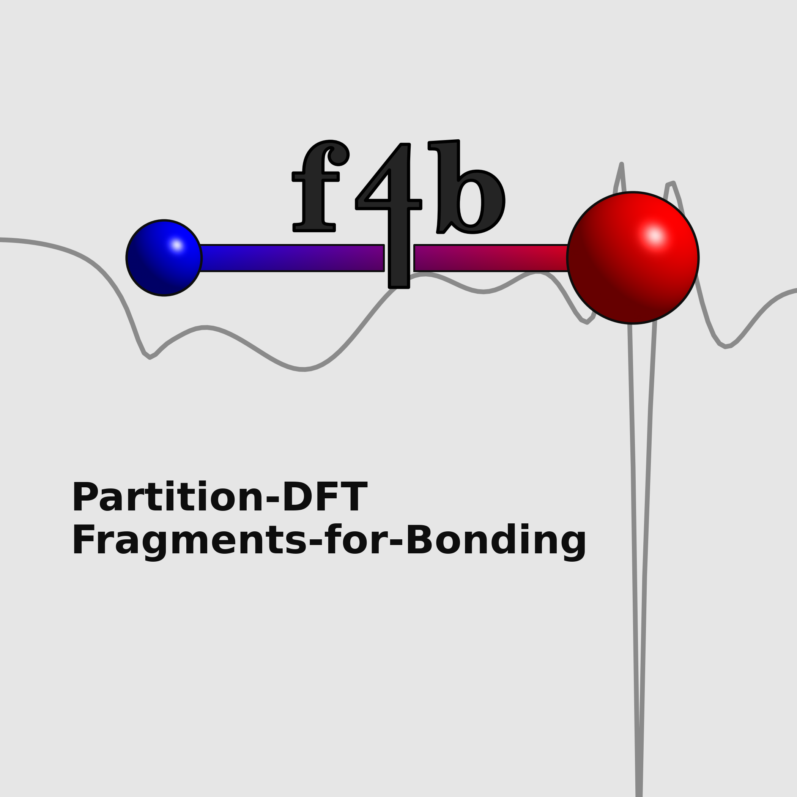

# f4b

<div align="center">
  
</div>

**Partition density functional theory (P-DFT) with a PySCF-like interface.**

`f4b` splits a molecule into fragments, solves each fragment with Kohn-Sham DFT in the presence of a common
*partition potential* `Vp`, and iterates `Vp` until the sum of the fragment densities (the promolecular density `n_f`)
reproduces the density of the whole molecule. The result is a set of fragment densities and energies that add up to the
target system, together with the partition energy `Ep` and the partition potential itself. The code is written for
studying fragment-based descriptions of molecules (including fragments with fractional electron numbers and
spin/configuration ensembles), not as a production electronic-structure code.

```python
from f4b import pdft, fgto

mol = fgto.M(atom='H 0 0 0; H 0 0 0.74', basis='cc-pvdz',
             fragments={0: [0], 1: [1]},          # fragment -> atoms (0-based)
             ensembles={'spin': [0, 1]})          # spin-symmetrized open-shell H atoms
mf = pdft.RKS(mol, method='inversion')
mf.kernel()
print(mf.e_tot, mf.Ep)
```

* Integrals, grids, functionals and SCF come from [PySCF](https://pyscf.org); PySCF is **not modified**.
* Kohn-Sham inversions use [n2v](https://github.com/wasserman-group/n2v) (Wu-Yang method).
* Everything lives in the AO basis of the whole molecule: fragments are PySCF `Mole` objects in which the other atoms
  are ghost atoms, so `Vp` and all densities are plain matrices of the same size.

## Contents

1. [Features](#features)
2. [Installation](#installation)
3. [Quick start](#quick-start)
4. [Defining the system: `fgto.M`](#defining-the-system-fgtom)
5. [Ensembles](#ensembles)
6. [Methods and the `pdft.RKS` object](#methods-and-the-pdftrks-object)
7. [Options](#options)
8. [Examples](#examples)
9. [Saving and resuming a calculation](#saving-and-resuming-a-calculation)
10. [Plotting densities and the partition potential](#plotting-densities-and-the-partition-potential)
11. [Accuracy and practical advice](#accuracy-and-practical-advice)
12. [Limitations](#limitations)
13. [Testing](#testing)
14. [Citing, funding, acknowledgements](#citing-funding-acknowledgements)

## Features

* Three ways to update the partition potential:
  `functional-T` (non-additive kinetic/XC functional), `inversion` (Kohn-Sham inversion of `n_f`) and
  `reference` (match a reference density, e.g. from HF, CCSD or a larger KS calculation).
* Any number of fragments (tested up to 4: H3+, H2O in three fragments, NH3 in four).
* Ensembles of fragments from simple inputs: fractional **electron numbers** per fragment (`{'charge': {0: 1.4, 1: 0.6}}`: the ions and weights are
  worked out), **spin** symmetrization of open-shell fragments, and **configuration** ensembles of degenerate shells (`{'config': [0]}`: the
  degenerate orbitals, their filling and the states are found automatically; the weights are optimized during the run).
* Ground-state spins of the fragments and of the members of the ensembles by Hund's rule (atoms, linear and symmetric molecules; `fspin` to override).
* Fragment point-group symmetry (`frag_symm='auto'`): equivalent fragments are solved once.
* Exact one-electron treatment (H2+) with no self-interaction error.
* Save a result to disk and resume from it (also with a different method): `mf.save(...)`, `restart=`, `Vp0=`, `dm0=`.
* Z-matrix geometries with dummy atoms, ghost atoms, user-defined evaluation grids, a reference-density input, and
  evaluation of `n_f` and `Vp` at arbitrary points.
* Only LDA and GGA functionals (no hybrids, no meta-GGAs).

## Installation

### Requirements

| | |
|---|---|
| Python | 3.8 (tested); other 3.x versions that provide a `psi4` build should work |
| PySCF | >= 2.6 (tested: 2.6.2 and 2.14.0) |
| numpy, scipy, opt_einsum | installed by `pip` |
| **psi4**, `libint` | **must come from conda** (psi4 cannot be installed with `pip`): `-c conda-forge psi4 libint=2.8.1`. psi4 is imported unconditionally by `n2v`; `f4b` itself only uses PySCF |
| `n2v` (PyPI name `ntov`), `pylibxc2`, `gbasis` | installed by `pip` automatically (`gbasis` is fetched from GitHub, so `git` must be available) |

### Recommended: new conda environment

```bash
conda create -n f4b -c conda-forge python=3.8 psi4 libint=2.8.1 git
conda activate f4b
pip install "git+https://github.com/wasserman-group/f4b.git"
```

`libint=2.8.1` (from conda-forge) is installed explicitly because some conda solutions pick a `libint` version that
`psi4` cannot load, and then `import psi4` (and with it `import n2v`/`import f4b`) fails with an error about the
`libint` library. If you already have an environment with this problem, fix it with
`conda install -c conda-forge libint=2.8.1`.

To work on the code (changes take effect immediately):

```bash
git clone https://github.com/wasserman-group/f4b.git
cd f4b
pip install -e ".[test]"
```

### Check the installation

```bash
python -c "from f4b import pdft, fgto; print('ok')"
python -m pytest tests -m "not slow"        # about 5 minutes; only if you cloned the repository
```

### Notes

* `n2v` is used through a small subclass inside `f4b` (`f4b/inversion.py`); both the released `n2v` and the development
  version work.
* `pip` installs the newest PySCF by default. If you need results identical to the development environment, use
  `pip install pyscf==2.6.2`.
* PySCF/n2v may write a `timer.dat` file in the working directory; it is safe to delete.
* If installing in Windows, we recommend the use of [WSL](https://docs.microsoft.com/en-us/windows/wsl/install-win10).
* If any unexpected error occurs, please contact Ulises I. Zarate Lopez at uzaratel@purdue.edu.

## Quick start

### H2 with the inversion method

```python
from f4b import pdft, fgto

mol = fgto.M(atom='H 0 0 0; H 0 0 0.74', basis='cc-pvdz',
             fragments={0: [0], 1: [1]}, ensembles={'spin': [0, 1]})
mf = pdft.RKS(mol, method='inversion')       # 'inversion' | 'functional-T' | 'reference'
mf.kernel()

mf.e_tot            # total energy (from a KS inversion of the final n_f)
mf.e_f              # sum of the fragment energies  E_f = sum_alpha E_alpha
mf.Ep               # partition energy  Ep = e_tot - e_f
mf.Vp               # partition potential, AO matrix (2, nao, nao) if spin-resolved
mf.converged        # see "Accuracy and practical advice"
mf.make_rdm1()      # (2, nao, nao): sum of the fragment spin densities;  make_rdm1(frag=0) for one fragment
mf.scf_summary      # dict: Ts, E_ext, E_H, E_xc, E_nn, per-fragment energies, niter, ...
```

### Compare with a plain Kohn-Sham calculation

```python
from pyscf import dft
ks = dft.RKS(mol.mol)          # mol.mol is the PySCF Mole of the whole system
ks.xc = 'PBE'; ks.grids.level = 6
ks.kernel()
print(mf.e_tot - ks.e_tot)
```

Use `grid_level=6` (the default) in both runs when comparing energies to better than 1e-4 Eh.

## Defining the system: `fgto.M`

`fgto.M(...)` takes the usual `pyscf.gto.M` keywords (`atom`, `basis`, `charge`, `spin`, `unit`, ...) plus the following ones.

| keyword | meaning |
|---|---|
| `fragments` | `{fragment: [atoms]}`, **0-based**; must contain every real atom exactly once. Default (`None`): one fragment per atom |
| `ensembles` | dict of ensembles (electron numbers, spin symmetrization, degenerate configurations), see [Ensembles](#ensembles). Default: none |
| `fcharge` | `{fragment: charge}`: charge of an ion fragment **without** charge ensemble, e.g. `{0: 1}` for He+ in HeH+. Missing fragments are neutral |
| `fspin` | `{fragment: 2S}` with `2S = N_alpha - N_beta` (as `spin` in PySCF; multiplicity = 2S + 1): spin of the fragment. Default: the ground-state spin by Hund's rule. Example: `{0: 0}` forces a singlet O atom |

Everything that takes a fragment or atom number is **0-based**, like PySCF (`frag=` in `make_rdm1`/`eval_density`, keys
of `mf.omega`, ...).

Each fragment is a PySCF `Mole` with the remaining atoms as ghost atoms (basis functions, no nucleus, no electrons).
The AO ordering is therefore identical in all fragments and in the whole system.

**Electron counts.** The fragment densities must add up to the total number of electrons of the whole system
(`mol.mol.nelectron`); this is checked when the problem is built. Only the *total* is checked: the alpha/beta split of the
fragments may differ from that of the whole system (for example, a charge ensemble with 1.3 alpha and 0.7 beta
electrons for a closed-shell H2 is accepted; the inversion target is then spin-unpolarized).

**Spin.** Every fragment (and every member of an ensemble) gets its ground-state spin by **Hund's rule** unless `fspin` (or
the `'spins'` of an explicit charge ensemble) says otherwise: O atom: triplet, F: doublet, CO: singlet, O2: triplet, CO-: doublet,
H3+ fragments: doublet, ... `fspin` applies to the neutral member of the fragment (the one with `Z - fcharge` electrons); the other members of a
charge ensemble use Hund's rule. How the spin is found is described in [Spin and shells](#spin-and-shells-hunds-rule).
An impossible spin (wrong parity, more unpaired electrons than electrons, negative) raises an error naming the fragment.

**Dummy and ghost atoms.** Z-matrix dummy centres (`X`) are dropped (no nucleus, no basis). Ghost atoms
(`ghost-H`, `X-H`) stay in the calculation but carry no nuclear charge. Neither belongs to a fragment: list in
`fragments` only the real atoms, numbered by their row in `atom` (dummy rows counted, 0-based). H3+ from a Z-matrix:

```python
atom = 'X; X 1 1.0; H 1 1.0 2 90.0; H 1 1.0 2 90.0 3 120.0; H 1 1.0 2 90.0 3 -120.0'
mol = fgto.M(atom=atom, unit='bohr', basis='cc-pvdz', charge=1,
             fragments={0: [2], 1: [3], 2: [4]},
             ensembles={'charge': {0: 2/3, 1: 2/3, 2: 2/3}})
```

`mol.mol` is the PySCF Mole (real and ghost atoms only), `mol.row2atom` maps input rows to its atom numbers.
`print(mol)` lists the members of every fragment (electrons, weights, configuration states).

## Ensembles

`ensembles` is a dict keyed by the ensemble type. Three types, all optional:

```python
ensembles = {
    'charge': {0: 1.4, 1: 0.6},      # average number of electrons of each fragment
    'spin':   [0, 1],                # spin-symmetrize the open-shell members of these fragments
    'config': [0],                   # degenerate configurations of these fragments (filled automatically)
}
```

### `'charge'`: fractional numbers of electrons

Give the **average number of electrons** of each fragment; `f4b` takes the two integers around it and works out the weights.
`{0: 1.4, 1: 0.6}` for H2 means

| fragment | electrons | members |
|---|---|---|
| 0 | 1.4 | H (weight 0.6) + H- (weight 0.4) |
| 1 | 0.6 | no electrons (weight 0.4) + H (weight 0.6) |

and `{0: 8.7, 1: 1.3}` for HF gives F+ (0.3) + F (0.7) and H (0.7) + H- (0.3). The numbers must add up to the electrons of the
molecule. An integer is "no ensemble" for that fragment. A fragment without entry keeps its integer electron number (`Z - fcharge`),
so `fcharge` is only needed for ion fragments without a charge ensemble (HeH+); if both are given for a fragment, `fcharge` is ignored with a warning.
Every member gets its ground-state spin (Hund's rule; `fspin` for the neutral member).

*Advanced form*: list the members by hand, `{0: {'charges': (0, -1), 'weights': (0.3, 0.7), 'spins': (None, 1)}}`. `charges` are relative to the
neutral fragment (`Z - fcharge` electrons; `+1` = one electron fewer, `-1` = one more, `None` = no electrons at all: zero density, no calculation), `weights`
are the total weights of the members (summing to 1) and `spins` the `2S` of each member (`None` = default); `spins` overrides `fspin`. It allows non-adjacent members.

### `'spin'`: spin-symmetrized fragments

A fragment (or a list of fragments) whose open-shell members are averaged with their spin-flipped partner (half of the weight each).
No extra calculation is needed for the flipped state. Typical for H atoms in H2, H3+, LiH, HeH+, HF, ...

### `'config'`: degenerate configurations, built automatically

A fragment whose last electrons occupy a *partly filled group of degenerate orbitals* (the 2p shell of F, the pi* pair of CO-, ...) has several degenerate
determinants, which are averaged in the ensemble with weights `omega` that are **optimized during the P-DFT loop**. `'config': [0]` asks for them
for fragment 0; `f4b` does the rest for **every member** of the fragment (every electron number of its charge ensemble) that needs it:

1. it finds the shells of the member from a symmetric calculation of the isolated fragment (see [Spin and shells](#spin-and-shells-hunds-rule));
2. it fills them with the member's spin (`fspin`/`spins` or Hund's rule) and lists the ways of placing the electrons of the partly filled group:
   `C(d, n)` states for `n` electrons of one spin in `d` degenerate orbitals;
3. it selects each state with a constrained-DFT population constraint on **holes** (population 0 in the empty orbitals, default) or on the **occupied**
   orbitals, with the shell orbitals oriented along the Cartesian axes (atoms) or the molecular axis (linear molecules);
4. it starts with equal weights.

Members without a partly filled degenerate shell (closed shells, half-filled shells, non-degenerate holes) are left unchanged; if none of the members of a requested fragment needs the ensemble, `f4b` warns.

```python
mol = fgto.M(atom='F 0 0 0; H 0 0 1.733', unit='bohr', basis='cc-pvdz', fragments={0: [0], 1: [1]},
             ensembles={'charge': {0: 8.7, 1: 1.3},      # F+ (triplet) + F (doublet): both have a partly filled 2p shell
                        'config': [0],                    # -> 3 + 3 configuration states, found automatically
                        'spin': [0, 1]})
print(mol)                                                # members, weights, configuration states
```

| how many states (Hund spin) | |
|---|---|
| F (2p5, doublet) / O- | 3 (one beta hole in px, py or pz) |
| F+ / O (2p4, triplet): two beta holes; C (2p2, triplet): one alpha hole | 3 |
| O+ (2p3), Ne, closed shells | none (unique) |
| CO-, O2+ (pi* with one alpha electron), O2- (one beta electron), benzene cation (e1g) | 2 |
| CO, O2 (triplet), CO+, H2O, O3 | none |

Forms of `'config'`:

```python
'config': [0, 1]                                  # fragments 0 and 1
'config': 'all'                                   # every fragment (those without degenerate shell are ignored)
'config': {0: {'fill': 'occupied'}}               # population-1 constraints on the occupied orbitals instead of holes
'config': {0: {'members': [9]}}                   # only the member with 9 electrons gets the ensemble
'config': {0: {'omega': (0.5, 0.3, 0.2)}}         # initial weights (equal by default); sequence of the right length ...
'config': {0: {'omega': {9: (0.5, 0.3, 0.2)}}}    # ... or {number of electrons: weights}
```

Holes are recommended: constraining the occupied orbitals gave states tens of mEh higher in tests (the electron is forced into the constrained localized orbital).
The weights are stored in `mf.omega[(fragment, charge)]` (`charge` relative to the neutral fragment); `optimize_omega=False` freezes them.

#### Spin and shells (Hund's rule)

For a fragment with `N` electrons, `f4b` runs a small calculation of the isolated fragment (no ghost atoms, LDA, spin-restricted) with **fractional
occupations**: `N/2` electrons per spin, shared equally by groups of degenerate orbitals. The density is then spherical (atoms) or cylindrical/symmetric,
and the degenerate orbitals are exactly degenerate (energies equal within 5e-5 Eh). The orbitals are filled in order of energy; the last, partly
filled group (`d` orbitals, `k` electrons) gets its electrons parallel first, so `N_alpha - N_beta = min(k, 2d - k)` (Hund's rule). It costs a fraction of a second for
small fragments (a few seconds for benzene) and is done once per fragment and electron number.

```python
print(mol.shells(0))        # shells of fragment 0 (neutral): degeneracy, energy, electrons, main AO components, Hund spin
print(mol.shells(0, 8))     # ... of the member with 8 electrons
```

This works for atoms, linear molecules and symmetric molecules (the benzene cation gives the two orientations of its e1g hole). Molecules without
degenerate orbitals (H2O, O3, ...) have non-degenerate shells: closed shells for an even number of electrons, doublets for an odd one, and no configuration ensemble. Limits:
the shells are those of the isolated, symmetric fragment; the aufbau order is the LDA one (transition metals, with close 3d/4s orbitals, were not tested: use `fspin`); if the spin is forced
so that both spin channels are partly filled (a singlet O atom) the states are the products (3 x 3 = 9), up to a limit of 60 states.

#### States by hand

The automatic ensembles use population constraints on orbitals; they can also be given explicitly (any fragment, any orbital), per charge of the fragment:

```python
f_ion = tuple(tuple((f'F 2p{k}', 'beta', 0.0) for k in pair) for pair in ('yz', 'xz', 'xy'))   # F+: two beta holes per state
f_neutral = tuple(((f'F 2p{k}', 'beta', 0.0),) for k in 'xyz')                                   # F : one beta hole per state
'config': {0: [{'charge': 1, 'states': f_ion},                                # a list of dicts: one per charge of the fragment
               {'charge': 0, 'states': f_neutral, 'omega': (0.2, 0.3, 0.5)}]}
```

Each state is a tuple of constraints `(orbital, spin, population)` (population 0 = hole, 1 = full spin orbital). The orbital is a localized (meta-Lowdin) AO given by a regular expression
that is looked up **among the AOs of the fragment's own atoms** (`'O 2px'` is enough for an O atom of O2; a label matching several orbitals of the fragment, or only orbitals
of other fragments, is an error; use the atom index, `'1 O 2px'`, when the fragment has several atoms of one element), an AO index, or a combination `{'C 2py': 1, '2 O 2py': -1}`
(normalized automatically). The `charge` is relative to the neutral fragment, like in the advanced charge form. A manual and an automatic configuration ensemble cannot be mixed for one fragment.
The states must be distinct (`f4b` warns when two states of a group converge to the same density).

Unknown keys raise an error.

## Methods and the `pdft.RKS` object

```python
mf = pdft.RKS(mol, method='functional-T', **options)
mf.kernel()
```

At every iteration the fragments are solved with the current `Vp` and `Vp += lam * sym(dVp)`.

| `method` | update `dVp` | needs |
|---|---|---|
| `'functional-T'` | `dTs/dn + v_ext + v_H + v_xc` evaluated on `n_f` (`Ts` = `'vW'`, `'TF'` or `'TFvW'`) | nothing |
| `'inversion'` | `v_xc^DFA[n_f] - v_xc^inv[n_f]` (Wu-Yang inversion of `n_f` on the whole system) | nothing |
| `'reference'` | `∫ φ_μ φ_ν (n_f - n_ref)` ; convergence measured by the L1 density error | `ref_dm=` or `nref=` |

Other P-DFT formulations from the literature (local-Q non-additive terms, direct method, ...) raise `NotImplementedError`.

Reference density: `ref_dm` is an AO density matrix of the whole system in the same basis (spin-summed `(nao, nao)` or
`(2, nao, nao)`), e.g. `ref_dm=uhf.make_rdm1()`; `nref` is a callable of the grid coordinates or a tuple `(mol, dm)` for a
density computed in a different basis. With any method, giving a reference makes `mf.L1()` available.

Results and tools:

| attribute / method | |
|---|---|
| `mf.e_tot`, `mf.e_f`, `mf.Ep`, `mf.Vp`, `mf.scf_summary` | energies and potential |
| `mf.converged`, `mf.niter`, `mf.history` | convergence information (per-iteration `Ef`, `dEf`, `\|dVp\|`, L1) |
| `mf.make_rdm1(frag=None)`, `mf.eval_density(coords, frag=None)` | fragment densities on the AO basis or on any grid |
| `mf.eval_Vp(coords, spin=None)` | local potential `Vp(r)` implied by the AO matrix (approximate) |
| `mf.L1(grid=None)` | L1 error `∫\|n_f - n_ref\|`, also on a user grid `(coords, weights)` |
| `mf.omega` | optimized configuration weights |

`E_total` is computed **once at the end**, from a Kohn-Sham inversion of the final `n_f`
(`E = Ts + E_ext + E_H + E_xc + E_nn`), and `Ep = E_total - E_f`.

## Options

Set options as keywords: `pdft.RKS(mol, method=..., name=value)`. Unknown names raise `TypeError`.

| option | default | meaning |
|---|---|---|
| `xc`, `fxc` | `'PBE'`, same as `xc` | functional of the whole system / of the fragments (LDA, GGA) |
| `Ts` | `'vW'` | kinetic functional for `functional-T` |
| `KSinv`, `Vguide`, `pbs` | `'WuYang'`, `'hartree'`, `'same'` | inversion: method, guide potential (`'hartree'` or `'fermi_amaldi'`), potential basis (`'same'` or a basis name such as `'aug-cc-pvqz'`) |
| `maxiter` | 100 (5000 for `reference`) | maximum number of P-DFT iterations |
| `lam`, `step` | 0.5, `None` | `Vp += lam*sym(dVp)`. `reference` uses `step` or an adaptive `2*L1`. `lam=1` is faster but can diverge |
| `dEf_min`, `L1_min` | 1e-6, 1e-3 | convergence thresholds (change of `E_f`; L1 for `reference`) |
| `inv_reg` | `1e-3` | lambda-regularization of the Wu-Yang inversions in the loop (`None`, a float or `'auto'`) |
| `final_reg`, `final_gtol` | `'auto'`, 1e-8 | same for the final inversion that gives `E_total` |
| `spin_vp` | `None` | spin-resolved `Vp`; on automatically for spin-polarized systems (e.g. H2+) |
| `one_electron` | `None` | exact one-electron mode; automatic when the whole system has one electron |
| `grid_level`, `fgrid_level` | 6, `None` | integration grid level (whole system; fragments, by default the same grid) |
| `frag_symm`, `frag_symm_tol` | `'none'`, 1e-4 | `'auto'` solves one fragment per symmetry orbit (coordinates must be exact, tolerance in bohr) |
| `Vp0` | `None` | initial `Vp`: AO matrix, `(2, nao, nao)` if spin-resolved, or a file written by `mf.save` |
| `dm0` | `None` | starting fragment densities (initial guesses of the fragment SCFs): file from `mf.save`, `{fragment: dm}` or a list of `dm` |
| `restart` | `None` | file from `mf.save`: `Vp0` + `dm0` + configuration weights of that run |
| `accel`, `diis_space`, `diis_start` | `None`, 8, 2 | `accel='diis'` enables Pulay extrapolation of `Vp` |
| `optimize_omega`, `omega_maxiter` | auto, 20 | optimization of configuration weights |
| `diverge_factor` | 20 | stop and keep the best iterate if the residual grows by this factor |
| `ref_dm`, `nref` | `None` | reference density |
| `verbose` | 1 | 0 = silent, 1 = one line per iteration |

## Examples

The folder `examples/` has a notebook for each of the cases below (H2, H2 with fractional electrons, H2+, H3+, H6 chain, HeH+, LiH, HF, CO2) and
two about the tools (`Shells_and_Hund_example`, `Restart_example`).

### Fragments with fractional charge: LiH

```python
from f4b import pdft, fgto
mol = fgto.M(atom='Li 0 0 0; H 0 0 3.014', unit='bohr', basis='cc-pvdz', fragments={0: [0], 1: [1]},
             ensembles={'charge': {0: 3.43174, 1: 0.56826},    # electrons of each fragment: Li + Li-, no electrons + H
                         'spin': [0, 1]})
mf = pdft.RKS(mol, method='inversion', inv_reg=1e-3, maxiter=40)
mf.kernel()
```

### H2 with fractional electrons only (no spin ensemble)

```python
mol = fgto.M(atom='H 0 0 0; H 0 0 0.74', basis='cc-pvdz', fragments={0: [0], 1: [1]},
             ensembles={'charge': {0: 1.7, 1: 0.3}})           # H + H- (0.3 / 0.7) and no electrons + H (0.7 / 0.3)
```
The same call works with or without `'spin': [0, 1]`.

### HF: charge transfer and degenerate configurations of F

```python
mol = fgto.M(atom='F 0 0 0; H 0 0 1.733', unit='bohr', basis='cc-pvdz', fragments={0: [0], 1: [1]},
             ensembles={'charge': {0: 9.2, 1: 0.8},   # F (0.8) + F- (0.2); H (0.8) + H+ (0.2)
                        'config': [0],                 # the three 2p-hole configurations of F, built and weighted automatically
                        'spin': [0, 1]})
mf = pdft.RKS(mol, method='reference', ref_dm=ks.make_rdm1())    # ks: a plain KS calculation of the molecule
mf.kernel()
print(mf.omega)                                                    # optimized configuration weights
```
With `{0: 8.8, 1: 1.2}` the fragment F is F+ (triplet, two beta holes) + F: both members get their configurations.

### CO2 as CO + O

```python
mol = fgto.M(atom='O 0 0 -2.2; C 0 0 0; O 0 0 2.2', unit='bohr', basis='6-31g', fragments={0: [1, 2], 1: [0]},
             ensembles={'charge': {0: 13.75, 1: 8.25},   # e.g. Mulliken populations of a KS calculation
                        'config': [1],                    # O (8 e) and O- (9 e): partly filled 2p
                        'spin': [0, 1]})
```
CO- (the extra electron in the degenerate pi* pair) would get the two configurations pi*_x and pi*_y automatically.

### Reference density from another method

```python
from pyscf import scf
mol = fgto.M(atom='H 0 0 0; H 0 0 1.4', unit='bohr', basis='aug-cc-pvqz',
             fragments={0: [0], 1: [1]}, ensembles={'spin': [0, 1]})
ref = scf.RHF(mol.mol).run()
mf = pdft.RKS(mol, method='reference', ref_dm=ref.make_rdm1(), step=5.0, maxiter=100, grid_level=5)
mf.kernel()
print(mf.L1())
```

### One-electron systems (H2+)

When the whole system has one electron, Hartree and exchange-correlation cancel exactly, so `f4b` switches to an exact
mode: fragments are solved with UHF, `dVp = dTs_vW/dn + v_ext` and `E = Ts_vW + E_ext + E_nn`. This removes the
self-interaction error of PBE (6.7 mEh for H2+ at 2 bohr).

```python
mol = fgto.M(atom=[['H', (-1, 0, 0)], ['H', (1, 0, 0)]], unit='bohr', basis='cc-pvqz', charge=1, spin=1,
             fragments={0: [0], 1: [1]}, ensembles={'charge': {0: 0.5, 1: 0.5}})     # half an electron on each H
pdft.RKS(mol, method='functional-T', accel='diis').kernel()      # agrees with UHF (exact) to ~5e-6 Eh
```

Use a large basis (cc-pVQZ or larger). `functional-T` is the accurate and fast choice here; `inversion` is limited by the
regularization (`inv_reg=1e-4`: about 2.5e-4 Eh) and `reference` converges slowly. `one_electron=False` returns to the
PBE description.

### HeH+

HeH+ has two electrons, so it uses the regular machinery:

```python
sep = 1.458869
mol = fgto.M(atom=[['He', (-sep/2, 0, 0)], ['H', (sep/2, 0, 0)]], unit='bohr', basis='cc-pvqz',
             charge=1, spin=0, fragments={0: [0], 1: [1]},
             fcharge={0: 1},                    # fragment 0 is He+ (no charge ensemble: fcharge sets its electrons)
             ensembles={'spin': [0, 1]})        # both fragments are doublets (Hund's rule)
```

### Symmetry-equivalent fragments

```python
mf = pdft.RKS(mol, method='functional-T', frag_symm='auto')
```
For H2O with fragments O, H, H only two fragment calculations are done and the two H densities are identical by
construction.

## Saving and resuming a calculation

The loops often stop at `maxiter` with a result that is not good enough yet. Store it and continue later, in the same
session or another one:

```python
mf = pdft.RKS(mol, method='reference', ref_dm=ref_dm, step=5.0, maxiter=100)
mf.kernel()
mf.save('h2_state')                     # writes h2_state.npz (the extension is added)

# later: a new object, same molecule/basis/fragments, 100 more iterations starting from the stored state
mf2 = pdft.RKS(mol, method='reference', ref_dm=ref_dm, step=5.0, maxiter=100, restart='h2_state.npz')
mf2.kernel()
```

`mf.save` stores the partition potential `Vp` (of the best iterate, the one that `mf.Vp` returns), the density of every
fragment-ensemble member, the ensemble-averaged fragment densities (`mf.make_rdm1(frag)`), the configuration weights
`omega` and the final energies. The reference density is **not** stored; pass `ref_dm`/`nref` again. The first iteration
of the resumed run reproduces the stored result (same L1 error for `reference`); the `maxiter` of the new run counts
from zero, and `mf2.history` only contains the new iterations.

The pieces can also be used independently, with **any** method (for example, start `inversion` from a `reference`
result):

| option | what it sets | accepted values |
|---|---|---|
| `Vp0` | initial partition potential | array `(nao, nao)` or `(2, nao, nao)`; file from `mf.save`; state loaded with `f4b.load_state` |
| `dm0` | starting density of the fragment SCFs | file from `mf.save`; `{fragment: dm}`; list with one `dm` per fragment. A `dm` is `(2, nao, nao)` spin densities or a spin-summed `(nao, nao)` |
| `restart` | everything above plus configuration weights | file from `mf.save` |

An explicit `Vp0` or `dm0` overrides the corresponding part of `restart`. `f4b.load_state(path)` returns a dict with `Vp`,
`frag_dm` (`(nfrag, 2, nao, nao)`), `members`, `omega` and `info` (energies, iterations, method) if you want to inspect or
plot a stored result without recomputing it.

```python
import f4b
st = f4b.load_state('h2_state.npz')
st['info']['e_tot'], st['Vp'].shape, st['frag_dm'].shape
mf3 = pdft.RKS(mol, method='inversion', Vp0='h2_state.npz', dm0='h2_state.npz')      # same as restart=
mf4 = pdft.RKS(mol, method='functional-T', Vp0=my_array, dm0=[dm_frag0, dm_frag1])   # user-built arrays
```

Notes:

* The densities of `dm0` are only **starting guesses** for the first SCF of each fragment (later iterations reuse the
  previous density): given `Vp`, the fragment densities are determined by the SCF, so `dm0` mainly saves SCF cycles and
  selects the SCF solution when there are several. The partition potential `Vp0` is what actually carries the progress
  of a run.
* Fractional-electron fragments are handled: a fragment density with a non-integer electron count (an ensemble average)
  is rescaled to the electron numbers of each member before being used.
* The new system must have the same atoms, basis and fragments (the arrays are matrices in the AO basis); a different
  `nao` or fragment number raises a `ValueError`. Method, functional, `lam`, grid, ... may differ.
* The DIIS history (`accel='diis'`) is not stored; it is rebuilt in the new run.
* With `frag_symm='auto'` only the symmetry-unique fragments have stored members; the rest are generated by symmetry.

## Plotting densities and the partition potential

`f4b` does not draw anything itself (matplotlib is not a dependency; `pip install matplotlib`). It evaluates the
quantities on any set of points `coords` of shape `(n, 3)` in **bohr**, and you plot the arrays:

| call | returns |
|---|---|
| `mf.eval_density(coords)` | `n_f(r)`, the sum of the fragment densities |
| `mf.eval_density(coords, frag=i)` | density of fragment `i` (0-based) |
| `mf.eval_Vp(coords)` | `Vp(r)`; for a spin-resolved `Vp` the spin average, or `spin=0/1` for one spin |

The target density comes from PySCF in the same way (`pyscf.dft.numint.eval_rho`). Example: densities and `Vp` along the
bond axis of H2, and a 2D map of `Vp`:

```python
import numpy as np
import matplotlib.pyplot as plt
from pyscf import dft
from pyscf.dft import numint
from f4b import pdft, fgto

mol = fgto.M(atom='H 0 0 -0.7; H 0 0 0.7', unit='bohr', basis='cc-pvtz',
             fragments={0: [0], 1: [1]}, ensembles={'spin': [0, 1]})
mf = pdft.RKS(mol, method='inversion', lam=1.0, maxiter=40, verbose=0)
mf.kernel()

# points on the molecular axis
z = np.linspace(-4, 4, 400)
line = np.column_stack([np.zeros_like(z), np.zeros_like(z), z])

n_f = mf.eval_density(line)                    # promolecular density
n_0 = mf.eval_density(line, frag=0)            # fragment densities
n_1 = mf.eval_density(line, frag=1)
vp  = mf.eval_Vp(line)

# target (plain KS) density on the same points
ks = dft.RKS(mol.mol); ks.xc = 'PBE'; ks.kernel()
n_ks = numint.eval_rho(mol.mol, numint.eval_ao(mol.mol, line), ks.make_rdm1())

fig, ax = plt.subplots(1, 2, figsize=(10, 4))
ax[0].semilogy(z, n_ks, 'k-', label='KS (target)')
ax[0].semilogy(z, n_f, 'r--', label='$n_f$')
ax[0].semilogy(z, n_0, 'b:', label='fragment 0')
ax[0].semilogy(z, n_1, 'g:', label='fragment 1')
ax[0].set_xlabel('z (bohr)'); ax[0].set_ylabel('n(r)'); ax[0].legend()
ax[1].plot(z, vp - vp[len(z) // 2], 'm-')      # Vp is defined up to a constant: fix a reference point
ax[1].set_xlabel('z (bohr)'); ax[1].set_ylabel('$v_p$(r) (Eh)')
fig.tight_layout(); fig.savefig('h2_line.png', dpi=150)

# 2D map of Vp in the xz plane (y = 0)
x = np.linspace(-3, 3, 120); zz = np.linspace(-4, 4, 160)
X, Z = np.meshgrid(x, zz)
pts = np.column_stack([X.ravel(), np.zeros(X.size), Z.ravel()])
V = mf.eval_Vp(pts).reshape(X.shape)
fig, ax = plt.subplots(figsize=(4.5, 5))
c = ax.contourf(X, Z, V - V.min(), 40, cmap='viridis'); fig.colorbar(c, label='$v_p$ (Eh)')
ax.set_xlabel('x (bohr)'); ax.set_ylabel('z (bohr)'); ax.set_aspect('equal')
fig.savefig('h2_vp2d.png', dpi=150)
```

For other cuts, change the points: along the x axis use `np.column_stack([x, 0*x, 0*x])`; for a plane, build a meshgrid as
above and reshape the result. To compare with the reference density of `method='reference'`, evaluate it with
`numint.eval_rho` as shown, or use `mf.L1(grid=(coords, weights))` for the integrated error on your own grid.

Notes on `Vp`:

* `Vp` is stored as an operator in the AO basis, not as a function. `eval_Vp` returns its local representation
  (the diagonal of the projected operator divided by that of the projector). It is accurate where the basis is
  complete enough, i.e. near the molecule, and is **not reliable far away**: the rise of `v_p` at the edges of the
  line plot above is a basis-set artifact, not physics. Use a larger basis to push the reliable region outwards.
* `Vp` is defined up to an additive constant (a gauge freedom); subtract its value at a chosen point before comparing
  runs, as done above.
* With a spin-resolved `Vp` (`spin_vp=True`, or automatic for spin-polarized systems) pass `spin=0` or `spin=1`
  to see each spin channel.
* The fragment densities add up to `n_f` exactly (`eval_density(coords) == sum_i eval_density(coords, frag=i)`).

## Accuracy and practical advice

* `n_f` is generally not v-representable, so plain Wu-Yang inversions can be reported as "unsuccessful" even with
  `|grad| ~ 1e-8`. Hence the lambda-regularization in the loop (`inv_reg`) and a ladder of regularizations in the final
  inversion that picks by gradient norm. A smaller `inv_reg` is more accurate for small systems (H2: 1e-4), a larger one
  more robust for bigger systems (LiH: 1e-3).
* The loops usually stop at `maxiter` or at the divergence guard with `converged=False` and return the **best iterate**
  (smallest gauge-free residual; smallest L1 for `reference`). This is expected and does not mean the result is wrong;
  follow `|dVp|`, `dEf` and L1 in the log (`verbose=1`). A constant shift of `Vp` is a gauge freedom and is removed from
  the residual.
* Small bases limit the accuracy: at cc-pVDZ the L1 error stays around 0.03-0.05 and energies differ from KS by
  1e-4 to 1e-3 Eh. Larger bases reproduce the literature values:

  | case | E(P-DFT) - E(KS-PBE), Eh |
  |---|---|
  | `inversion`, H2 R = 1.4 bohr, cc-pVTZ, `pbs='aug-cc-pvqz'`, `lam=1`, 40 iterations | +7e-7 |
  | `functional-T`, H2 R = 1.424 bohr, cc-pVQZ, vW | +2e-7 |
  | `reference`, H2 R = 1.4 bohr, aug-cc-pVQZ, `step=5`, 100 iterations (L1 = 0.004) | +5e-5 |
  | `inversion`, LiH R = 3.014 bohr, cc-pVDZ, charge + spin ensembles | +4e-4 |

* Fragment symmetry (`frag_symm='auto'`) needs exact coordinates (default tolerance 1e-4 bohr).
* `inversion` runs that stop at `maxiter` are not bit-reproducible (multithreaded linear algebra feeds a sensitive
  optimizer): the energy of two identical runs can differ by 1e-5 Eh and, at small bases, occasionally by ~1e-3 Eh.
  Converged runs and the other methods are much more stable. Repeat a run before trusting differences below 1e-3 Eh.

## Limitations

* LDA/GGA functionals only; no hybrid or meta-GGA functionals.
* Fragment basis = whole-system basis.
* H2O (O, H, H) and NH3 (four fragments) run, but converge slowly with the plain `Vp` iteration; expect tens of mEh
  above KS after about 60 iterations unless `lam` is tuned or `accel='diis'` is used.
* Configuration ensembles converge with `reference` (HF/6-31G: ~2 mEh from KS-PBE in ~80 iterations) but are
  experimental with `inversion`: the weight optimization is non-convex and may jump between configurations. A good start
  is `Vp0=` from a `reference` run (see [Saving and resuming](#saving-and-resuming-a-calculation)).
* In the one-electron mode `inversion` and `reference` converge slowly; configuration ensembles are not supported.
* Automatic configuration ensembles need *exactly degenerate* shells in the symmetric isolated fragment (atoms, linear and symmetric molecules);
  other situations (or other choices of states) are given by hand. A fragment whose spin is forced so that both spin channels are partly filled produces product states (limit 60).
* The default spin of v0.1.0 was the lowest one (singlet/doublet); it is now the Hund-rule ground state (a triplet O atom, a quartet N atom, ...). Use `fspin` to get the old behavior.
* Not implemented: local-Q non-additive terms, post-P-DFT corrections, the direct method, spin-resolved `reference`,
  fragment basis different from the system basis, `frag_symm` with configuration ensembles.

## Testing

```bash
python -m pytest tests -m "not slow"      # H2, H2+, H3+, symmetry, spins, automatic ensembles, configuration ensembles (about 5 minutes)
python -m pytest tests                    # adds the slow LiH test
```

`scripts/validate_notebooks.py [inversion|functional|reference|lih]` reproduces the larger-basis runs of the table above.

## Citing, funding, acknowledgements

### Cites
* 2020 Program Update: Q. Sun et al., "Recent developments in the PySCF program package," J. Chem. Phys. 153, 024109 (2020). DOI: 10.1063/5.0006074
* Shi Y, Chávez VH, Wasserman A. n2v: A density-to-potential inversion suite. A sandbox for creating, testing, and benchmarking density functional theory inversion methods. WIREs Comput Mol Sci. 2022; 12:e1617. https://doi.org/10.1002/wcms.1617

### Funding
* This work was supported by the U.S. National Science Foundation (NSF) under Grant No. CHE-2306011. 
* Calculations used Anvil at Purdue through allocation CHE240225 from the Advanced Cyberinfrastructure Coordination Ecosystem: Services & Support (ACCESS) program.

### Acknowledgements
A special thanks to [Ralph Razzouk](https://ralphrazzouk.com/) for his guide when developing this package. 

## License
This project is licensed under the BSD 3-Clause License - see the [LICENSE](LICENSE) file for details.

## Copyright 
Copyright (c) 2026, Wasserman Group  
